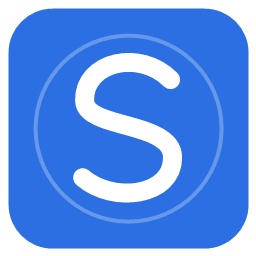
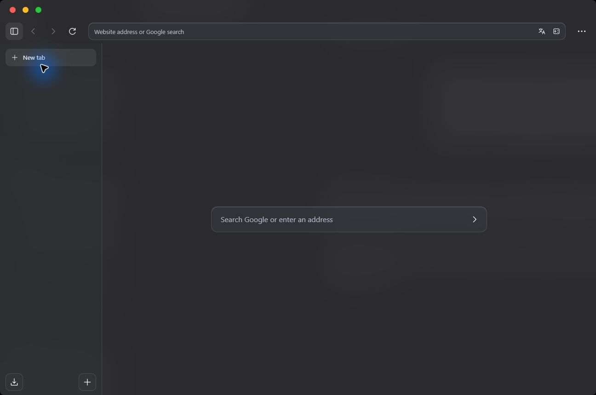
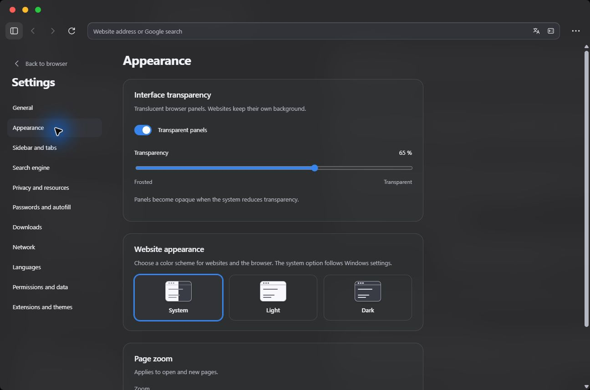
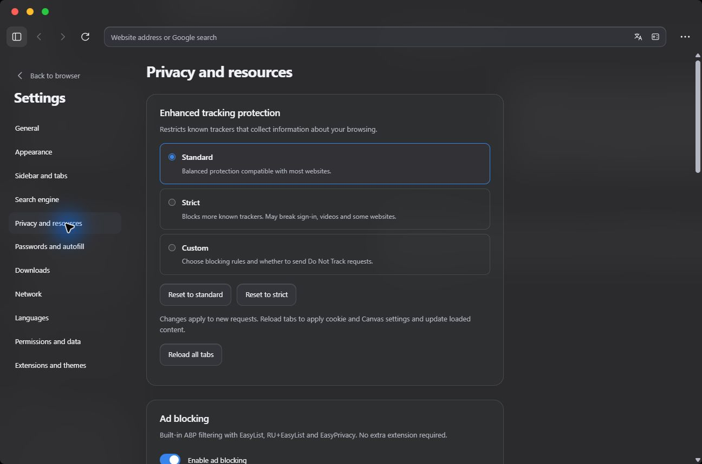

<div align="center">
  
  <h1>Slim Browser</h1>
  <p>A quieter workspace for the web. Built for Windows.</p>
  <p><a href="https://github.com/sqwizix/slim-browser/releases/latest">Download</a> · <a href="#features">Features</a> · <a href="#build-from-source">Build</a> · <a href="CONTRIBUTING.md">Contribute</a></p>
  <p>    <a href="LICENSE"></a></p>
  <p><strong>English</strong> · <a href="README.ru.md">Русский</a></p>
</div>



Slim Browser is an independent open source browser for Windows 11 x64. It brings
vertical tabs, translucent panels and built-in privacy controls into a restrained
interface. The app is written in **Rust**, its embedded shell uses **HTML, CSS and
JavaScript**, and websites run in the system **Microsoft Edge WebView2 Evergreen**
runtime through Wry and Win32 APIs.

## Features

| Your workspace | What you can do |
| --- | --- |
| Vertical tabs | Group pages into folders, drag to reorder, pin, duplicate, mute and move tabs between windows. |
| Three layouts | Keep everything in one sidebar, separate the address bar, or use compact tabs. Resize or hide the sidebar. |
| Appearance | Follow Windows, choose light or dark, adjust panel transparency and page zoom. |
| Russian and English | Switch the interface immediately in Settings → Languages. Restart to fully apply the engine language. |
| Search and translation | Choose Google, Bing or DuckDuckGo. Translate pages through Google Translate. |
| Built-in protection | Ad and tracker filtering, standard/strict/custom protection, site exceptions and blocking counters. |
| Private windows | Use a separate in-memory browsing session. Downloaded files and bookmarks are still kept. |
| Passwords | Save credentials with Windows DPAPI and autofill one matching account on its exact HTTPS origin. |
| Downloads | Pause, resume where supported, reveal files and choose byte or bit display units. |
| Site controls | Manage per-origin permissions, cookies, history, cached files and cleanup on exit. |
| Extensions | Install supported publisher packages through the built-in store after reviewing permissions. |
| DNS and resources | Configure IPv4/IPv6 DNS and DoH for the browser; unload inactive tabs to free memory. |
| Windows integration | Open external links, choose the default browser in Windows, share links and capture the visible page. |

<table><tr><td></td><td></td></tr></table>

## Install

1. Download **SlimBrowser-0.5.0-Setup.msi** from [Releases](https://github.com/sqwizix/slim-browser/releases/latest).
2. Install [WebView2 Evergreen Runtime](https://developer.microsoft.com/microsoft-edge/webview2/) if it is missing on your **Windows 11 x64** computer.
3. Run the MSI, then open **Slim Browser** from the Start menu.
4. Optional: Settings → General → **Choose Slim Browser in Windows**, then select HTTP, HTTPS and HTML associations in Windows.

The MSI installs for your Windows user, normally in `%LOCALAPPDATA%/Programs/Slim Browser`.
For the portable version, extract the entire ZIP and run `SlimBrowser.exe`.
Keep `ThirdParty.zip` with the distribution. Rust and .NET are not needed to run the current app.
Releases are unsigned; Windows may show the publisher as unknown.

Close Slim Browser before updating. The profile is in `%LOCALAPPDATA%/SlimBrowserRust`;
uninstalling the app preserves it.

## Build from source

Install stable [Rust with the MSVC toolchain](https://rustup.rs/), Visual Studio
Build Tools with **Desktop development with C++**, and a Windows SDK.
Use Node.js 22+ for JavaScript tests and Python 3.11+ for the notices tool.

```powershell
git clone https://github.com/sqwizix/slim-browser.git
cd slim-browser
.\build-rust.ps1 -Test -OutputDirectory artifacts/SlimBrowser-0.5.0
node --test rust/ui/*.test.cjs rust/tests/*.test.cjs
```

Output: `artifacts/SlimBrowser-0.5.0/SlimBrowser-Rust.exe`.
The `-Test` option runs Rust tests and a real WebView2 smoke test in an isolated profile.
See the [development guide](rust/README.md) for linting, packaging and source layout.

## Privacy and practical limits

There is no app-owned analytics or account sync service. Search providers,
websites, extensions, WebView2 and its updates can make their own network requests.
Google translation sends the selected page URL to Google.

- The system Chromium-based runtime is used. Compatibility with every Chrome extension is not guaranteed.
- Ad/tracking lists are November 2026 snapshots without automatic updates. YouTube changes can require updated rules; universal ad removal is not guaranteed.
- WebView2 does not offer Firefox-style Total Cookie Protection. Fingerprinting restrictions can affect sites and do not guarantee anonymity.
- Sleeping tabs reload and may lose unsaved forms. There is no fixed RAM cap or published benchmark comparison.
- DPAPI binds passwords to the Windows user; it cannot protect against malware running as that user.
- There is no automatic browser updater. Install new releases manually; WebView2 updates separately.
- Some extension account flows and VPN functionality need further testing. OS dialogs, websites and extension interfaces use their own languages.

## Project layout

```text
rust/src/             Rust app, WebView2, privacy and persistence
rust/ui/              Embedded HTML/CSS/JavaScript shell and UI tests
rust/ui/locales/      English translations; Russian source messages are keys
rust/assets/          Icon, filter sources and third-party notices
packaging/            MSI and Windows registration tools
.github/workflows/    Windows build and checks
docs/images/          Screenshots from the running application
```

## Questions and support

Questions about Slim Browser? Contact **[@sqwizix on Telegram](https://t.me/sqwizix)**.
For reproducible bugs and feature requests, use [GitHub Issues](https://github.com/sqwizix/slim-browser/issues).

## Contributing and license

Read [CONTRIBUTING.md](CONTRIBUTING.md), report bugs in
[Issues](https://github.com/sqwizix/slim-browser/issues), or send a focused pull request.

Original Slim Browser code uses [MIT](LICENSE). Dependencies and filter lists
retain their own licenses: see [third-party notices](THIRD_PARTY_NOTICES.md) and `ThirdParty.zip`.
Presentation inspired by [Zen Browser](https://github.com/zen-browser/desktop).
Slim Browser is independent and does not include Zen branding or source code.
