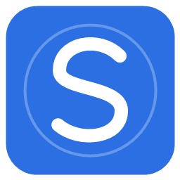
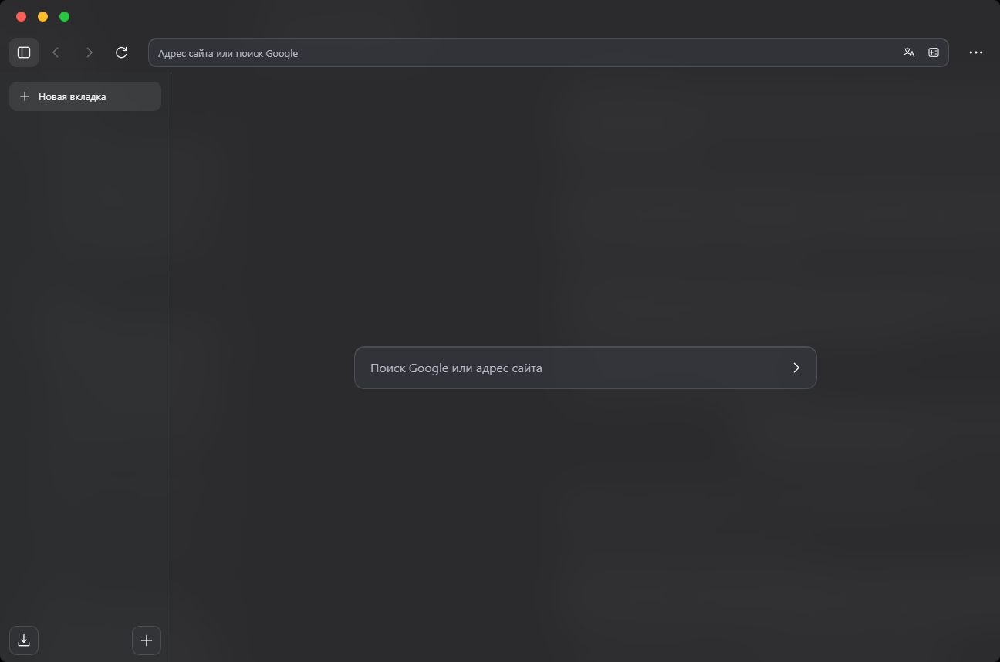
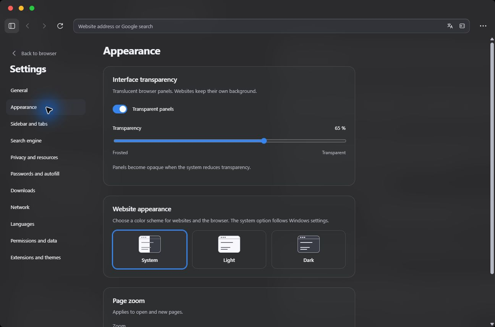
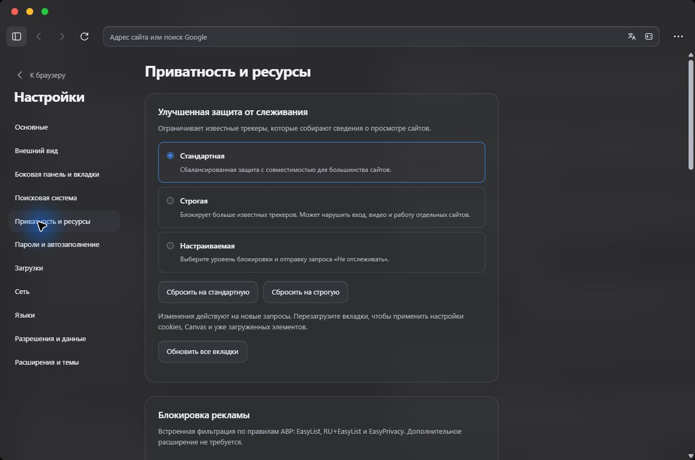

<div align="center">
  
  <h1>Slim Browser</h1>
  <p>Больше места для интернета. Меньше лишнего.</p>
  <p><a href="https://github.com/sqwizix/slim-browser/releases/latest">Скачать</a> · <a href="#возможности">Возможности</a> · <a href="#сборка-из-исходников">Сборка</a> · <a href="CONTRIBUTING.md">Участие в проекте</a></p>
  <p><a href="README.md">English</a> · <strong>Русский</strong></p>
</div>



**Slim Browser** — независимый браузер с открытым исходным кодом для **Windows 11 x64**.
Вертикальные вкладки, полупрозрачные панели и встроенная защита собраны в спокойном
интерфейсе. Приложение написано на **Rust**, оболочка — на **HTML, CSS и JavaScript**.
Страницы открываются в системном **Microsoft Edge WebView2 Evergreen** через Wry и Win32 API.

## Возможности

| Раздел | Что доступно |
| --- | --- |
| Вертикальные вкладки | Папки, перетаскивание, закрепление, дублирование, отключение звука и перенос между окнами. |
| Три макета | Всё в одной панели, отдельная адресная строка или компактные вкладки. Ширину панели можно менять, саму панель — скрыть. |
| Оформление | Системная, светлая и тёмная схемы; прозрачность панелей и масштаб страниц. |
| Русский и английский | Язык оболочки меняется сразу: Настройки → Языки. Для полного применения языка движка нужен перезапуск. |
| Поиск и перевод | Google, Bing или DuckDuckGo; перевод страниц через Google Переводчик. |
| Встроенная защита | Фильтрация рекламы и трекеров, стандартный, строгий и настраиваемый режимы, исключения и счётчик блокировок. |
| Приватные окна | Отдельная сессия в памяти. Скачанные файлы и добавленные закладки сохраняются. |
| Пароли | Шифрование Windows DPAPI, автозаполнение одного аккаунта при точном совпадении HTTPS-origin. |
| Загрузки | Пауза и продолжение, если сервер поддерживает, показ файла, размеры и скорость в байтах или битах. |
| Данные сайтов | Разрешения по origin, cookies, журнал, кэш и выборочная очистка при выходе. |
| Расширения | Встроенный магазин поддерживаемых пакетов с просмотром разрешений перед установкой. |
| Сеть и память | IPv4/IPv6 DNS и DNS over HTTPS для браузера; выгрузка неактивных вкладок. |
| Windows | Внешние ссылки, выбор браузера по умолчанию через параметры Windows, отправка ссылки и снимок видимой части страницы. |

<table><tr><td></td><td></td></tr></table>

## Установка

1. Откройте [Releases](https://github.com/sqwizix/slim-browser/releases/latest) и скачайте **SlimBrowser-0.5.0-Setup.msi**.
2. На компьютере с **Windows 11 x64** установите [WebView2 Evergreen Runtime](https://developer.microsoft.com/microsoft-edge/webview2/), если он отсутствует.
3. Запустите MSI и откройте **Slim Browser** из меню «Пуск».
4. По желанию: Настройки → Основные → **Выбрать Slim Browser в Windows**, затем выберите привязки HTTP, HTTPS и HTML в системном окне.

Установка выполняется для текущего пользователя; обычный путь — `%LOCALAPPDATA%/Programs/Slim Browser`.
Для portable-версии распакуйте весь ZIP и запустите `SlimBrowser.exe`.
Сохраняйте `ThirdParty.zip` рядом с распространяемой сборкой. Для запуска не нужны Rust и .NET.
Сборки не подписаны сертификатом; Windows может показывать неизвестного издателя.

Перед обновлением закройте браузер. Профиль хранится в `%LOCALAPPDATA%/SlimBrowserRust`
и остаётся после удаления приложения.

## Сборка из исходников

Нужны стабильный [Rust с MSVC toolchain](https://rustup.rs/), Visual Studio Build Tools
с компонентами **«Разработка классических приложений на C++»** и Windows SDK.
Для JavaScript-тестов нужен Node.js 22+, для генерации уведомлений о лицензиях — Python 3.11+.

```powershell
git clone https://github.com/sqwizix/slim-browser.git
cd slim-browser
.\build-rust.ps1 -Test -OutputDirectory artifacts/SlimBrowser-0.5.0
node --test rust/ui/*.test.cjs rust/tests/*.test.cjs
```

Результат: `artifacts/SlimBrowser-0.5.0/SlimBrowser-Rust.exe`.
Параметр `-Test` запускает модульные тесты Rust и интеграционную проверку реального
WebView2 в изолированном профиле. Подробности — в [руководстве разработчика](rust/README.md).

## Приватность и ограничения

Собственной аналитики и сервиса синхронизации аккаунтов нет. Поисковики, сайты,
расширения, WebView2 и его обновления могут выполнять собственные сетевые запросы.
Перевод страницы передаёт её адрес Google.

- Используется системный движок на Chromium. Совместимость всех расширений Chrome не гарантируется.
- Списки фильтрации — снимок ноября 2026 года, автоматического обновления пока нет. Изменения YouTube могут потребовать новых правил; удаление любой рекламы не гарантируется.
- WebView2 не предоставляет Firefox Total Cookie Protection. Ограничение отпечатков может нарушать сайты и не гарантирует анонимность.
- Выгруженная вкладка загружается заново; несохранённые формы могут потеряться. Жёсткого лимита RAM и опубликованных сравнительных замеров нет.
- DPAPI привязывает пароли к пользователю Windows, но не защищает от вредоносных программ, работающих от его имени.
- Автообновления браузера нет: новые версии устанавливаются вручную. WebView2 обновляется отдельно.
- Некоторые входы в аккаунты расширений и VPN требуют дополнительной проверки. Системные диалоги, сайты и расширения используют собственные языки.

## Технологии и структура

| Папка | Содержимое |
| --- | --- |
| `rust/src/` | Rust-приложение, WebView2, защита, сеть и хранение данных |
| `rust/ui/` | HTML/CSS/JavaScript оболочка и её тесты |
| `rust/ui/locales/` | Английский каталог; русские исходные сообщения служат ключами |
| `rust/assets/` | Иконка, исходники фильтров, лицензии зависимостей |
| `packaging/` | Сборка MSI и регистрация в Windows |
| `.github/workflows/` | Проверки и сборка для Windows |
| `docs/images/` | Скриншоты работающего приложения |
| `*.cs` в корне | Сохранённая ранняя версия на C# / WinForms; в актуальный EXE не входит |

## Участие и лицензия

Ошибки и предложения — в [Issues](https://github.com/sqwizix/slim-browser/issues).
Перед изменениями прочитайте [CONTRIBUTING.md](CONTRIBUTING.md).

Собственный код Slim Browser распространяется по [MIT](LICENSE). Зависимости и
списки фильтрации сохраняют свои лицензии: [уведомления](THIRD_PARTY_NOTICES.md), `ThirdParty.zip`.
Оформление страницы вдохновлено [Zen Browser](https://github.com/zen-browser/desktop).
Slim Browser — самостоятельный проект, без исходников и брендинга Zen.
